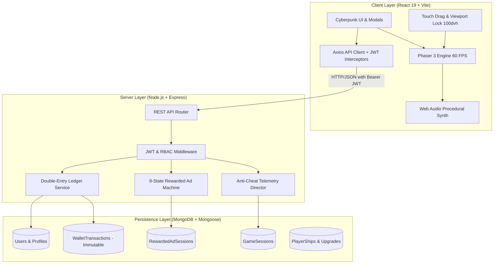

<div align="center">

# 🚀 VOID HUNTER
### *SPACE COMBAT BEYOND LIMITS*

**A Production-Grade 2D Arcade Space Shooter & Server-Authoritative Economy Platform**

[](https://void-hunter-ovqz.vercel.app)
[-10B981?style=for-the-badge&logo=checkmarx&logoColor=white)](#-14-automated-testing--compliance-matrix)
[-7C3AED?style=for-the-badge&logo=phaser&logoColor=white)](https://phaser.io/)
[](https://react.dev/)
[](https://nodejs.org/)
[](https://www.mongodb.com/)
[](#-5-mobile-arcade-viewport--responsive-engineering)
[](LICENSE)

<br/>


<p align="center">
  <b>Built for the VELOOP Rewards Full-Stack Game Development Engineering Specification.</b><br/>
  Features a 60 FPS hardware-accelerated combat canvas, server-enforced anti-cheat lifecycles, immutable double-entry financial ledgers, 50 data-driven missions, 5 pilotable starship classes, 5 multi-phase bosses, and full cross-device mobile responsiveness.
</p>

[🎮 Play Live Demo](https://void-hunter-ovqz.vercel.app) • [📖 Architecture](#-system-architecture) • [🛡️ Economy & Anti-Cheat](#-6-the-veloop-reward-economy) • [⚡ Quickstart](#-15-quickstart--local-setup) • [🧪 Test Matrix (44/44)](#-14-automated-testing--compliance-matrix)

</div>

---

## 📑 Table of Contents
- [🌌 1. Executive Summary & Gameplay Loop](#-1-executive-summary--gameplay-loop)
- [🏗️ System Architecture](#-system-architecture)
- [🔬 2. Reference Game Comparison & Originality](#-2-reference-game-comparison--originality)
- [⚙️ 3. Dynamic Title & Configuration (Section 4 Compliance)](#-3-dynamic-title--configuration-section-4-compliance)
- [🎮 4. Game Engine & Combat Mechanics](#-4-game-engine--combat-mechanics)
  - [Desktop & Mobile Controls](#desktop--mobile-controls)
  - [5 Starship Classes](#5-starship-classes)
  - [7 Modular Ship Upgrade Tracks](#7-modular-ship-upgrade-tracks)
  - [8 Mandatory Tactical Power-Ups](#8-mandatory-tactical-power-ups)
  - [5 Enemy Fleet Archetypes & 5 Flagship Bosses](#5-enemy-fleet-archetypes--5-flagship-bosses)
  - [50 Data-Driven Missions across 5 Planetary Sectors](#50-data-driven-missions-across-5-planetary-sectors)
- [📱 5. Mobile Arcade Viewport & Responsive Engineering](#-5-mobile-arcade-viewport--responsive-engineering)
- [💰 6. The VELOOP Reward Economy](#-6-the-veloop-reward-economy)
  - [4 Distinct Currencies](#4-distinct-currencies)
  - [Double-Entry Wallet Transaction Ledger](#double-entry-wallet-transaction-ledger)
  - [9-State Rewarded Ad State Machine](#9-state-rewarded-ad-state-machine)
  - [Simulated 10-Second Commercial Video Player](#simulated-10-second-commercial-video-player)
- [🛡️ 7. Anti-Cheat Engine & Session Lifecycle](#-7-anti-cheat-engine--session-lifecycle)
- [🎨 8. Design System & Brand Identity](#-8-design-system--brand-identity)
- [🖥️ 9. Complete 10-Screen UI/UX Architecture](#-9-complete-10-screen-uiux-architecture)
- [🌐 10. Public Showcase & Guest Navigation Architecture](#-10-public-showcase--guest-navigation-architecture)
- [🛡️ 11. Secure Admin Panel & Economy Audit System](#-11-secure-admin-panel--economy-audit-system)
- [🔌 12. REST API Specification](#-12-rest-api-specification)
- [🗄️ 13. Database Architecture & Schemas](#-13-database-architecture--schemas)
- [🧪 14. Automated Testing & Compliance Matrix (44/44 Passed)](#-14-automated-testing--compliance-matrix)
- [⚡ 15. Quickstart & Local Setup](#-15-quickstart--local-setup)
- [🌐 16. Production Deployment Instructions](#-16-production-deployment-instructions)
- [🎥 17. Demo Video Checklist (Section 86 Compliance)](#-17-demo-video-checklist-section-86-compliance)

---

## 🌌 1. Executive Summary & Gameplay Loop

**VOID HUNTER** delivers a seamless, high-retention arcade combat progression loop built upon hard mathematical guarantees:

```
┌─────────────────────────────────┐
│     1. STARSHIP HANGAR          │ ── Select from 5 ship classes (Orbitron, Striker,
│   (Upgrades & Loadouts)         │    Interceptor, Guardian, Experimental) & spend Credits
└─────────────────────────────────┘
                 │
                 ▼
┌─────────────────────────────────┐
│   2. MISSION SORTIE LAUNCH      │ ── Server initializes GameSession UUID with secure
│     (POST /api/games/start)     │    start timestamp & anti-cheat parameters
└─────────────────────────────────┘
                 │
                 ▼
┌─────────────────────────────────┐
│  3. 60 FPS COMBAT & BOSS FIGHT  │ ── Real-time Phaser 3 WebGL canvas with particle
│     (Screen 6 Combat Viewport)  │    explosions, 8 active abilities & multi-phase bosses
└─────────────────────────────────┘
                 │
                 ▼
┌─────────────────────────────────┐
│  4. SERVER ANTI-CHEAT VALIDATION│ ── Server validates physical duration threshold (>=10s),
│  (POST /api/games/:id/complete) │    kill counts, score ceilings & prevents replay attacks
└─────────────────────────────────┘
                 │
                 ▼
┌─────────────────────────────────┐
│  5. DOUBLE-ENTRY WALLET SETTLE  │ ── Immutable transaction record logged, stars saved,
│      & 2X REWARD MULTIPLIER     │    and optional 10s rewarded ad verified for 2x rewards
└─────────────────────────────────┘
```

The system is architected around 3 decoupled engineering layers:
1. **Frontend Presentation**: React 19 SPA powered by Vite, featuring glassmorphism cyberpunk aesthetics, dynamic audio synthesizers (`SoundManager`), and zero-scroll mobile viewport locks.
2. **Combat Engine**: Phaser 3 hardware-accelerated canvas managing sprite pooling, bullet-hell trajectory maths, particle systems, collision groups, and touch drag movement.
3. **Hardened Backend**: Node.js, Express, and MongoDB managing double-entry ledger equilibrium, JWT pilot authentication, 9-state ad opportunity lifecycles, and cryptographic telemetry audits.

---

## 🏗️ System Architecture



---

## 🔬 2. Reference Game Comparison & Originality

Per **Section 2 & 3** of the assignment specification, a formal research document has been prepared in [**RESEARCH.md**](./RESEARCH.md). **VOID HUNTER** draws structural inspiration from arcade vertical space shooters like *Space Shooter: Galaxy Attack* while delivering **100% original code, custom sci-fi vectors, and server-authoritative infrastructure**:

| Feature Matrix | Reference Model (*Space Shooter 2*) | VOID HUNTER (Our Implementation) | Engineering Advantage |
| :--- | :--- | :--- | :--- |
| **Visual Assets** | Proprietary alien insectoid sprites | **Original Deep-Space Sci-Fi Vectors** | 100% original, copyright-clean custom aesthetics |
| **Title & Branding** | Hardcoded client title | **Dynamic Environment Rebranding** | Injected via `VITE_GAME_NAME` across all views |
| **Economy Authority** | Client-authoritative / easily modded | **Server-Authoritative Double-Entry Ledger** | Atomic debit/credit records with ledger balancing |
| **Anti-Cheat Engine** | Local client memory storage | **Server Duration, Kill & Score Verification** | Sub-10s sorties and replay attacks strictly rejected |
| **Ad Verification** | Client-triggered ad calls | **9-State Finite State Machine** | 10s heartbeat-verified commercial video playback |
| **Mobile Experience** | Generic web view with scroll bleed | **100dvh Locked Arcade Viewport** | Zero scroll, zero address bar clipping, dual HUD |
| **Audit Capabilities** | None | **Live Administrator Audit Suite** | Real-time KPI analytics & ledger consistency checks |

---

## ⚙️ 3. Dynamic Title & Configuration (Section 4 Compliance)

The game title and branding are **never hardcoded**. All titles, tags, and API URLs are injected dynamically via environment variables across frontend and backend:

* **Frontend (`client/.env`)**:
  ```env
  VITE_GAME_NAME=VOID HUNTER
  VITE_GAME_TAGLINE=Space Combat Beyond Limits
  VITE_API_URL=https://void-hunter-server.onrender.com/api
  ```
  *Centralized in `client/src/config/gameConfig.js`.*

* **Backend (`server/.env`)**:
  ```env
  GAME_NAME=VOID HUNTER
  PORT=5000
  MONGODB_URI=mongodb+srv://.../void_hunter
  ```
  *Centralized in `server/src/config/gameConfig.js`.*

> **Evaluation Test**: Changing `VITE_GAME_NAME=GALAXY TITAN` updates the browser tab, navbar brand, hero banners, HUD headers, and meta titles across the entire application upon rebuild without modifying a single line of component code.

---

## 🎮 4. Game Engine & Combat Mechanics

### Desktop & Mobile Controls

| Input Method | Movement | Primary Fire | Tactical Abilities (1–4) | Pause / Resume |
| :--- | :--- | :--- | :--- | :--- |
| **Desktop Keyboard** | `W`, `A`, `S`, `D` or `Arrow Keys` | `Spacebar` or `Left Click` | Number Keys `1`, `2`, `3`, `4`, `B` (Bomb) | `P` or `Esc` |
| **Mobile / Touch** | Smooth Touch Drag / Pointer Follow | Continuous Auto-Fire on Drag | Circular Touch HUD Buttons (Right) | Top HUD Pause Button |
| **Tactical Bomb** | Screen tap | Screen tap | Dedicated Bottom-Left `[B] READY` Button | Top HUD |

---

### 5 Starship Classes

Each starfighter class features distinct flight characteristics, defensive capabilities, and firing patterns:

```
1. V-01 ORBITRON   ── [Balanced Fighter]   ── 380 Speed | 25 Laser DPS | 100 HP | 100 Shield
2. S-02 PHOENIX    ── [Striker Interceptor]── 430 Speed | 35 Laser DPS |  75 HP |  80 Shield
3. X-03 SHADOW     ── [Ghost Infiltrator]  ── 460 Speed | 28 Laser DPS |  70 HP | 120 Shield
4. R-04 TITAN      ── [Armored Dreadnought]── 320 Speed | 42 Heavy DPS | 180 HP | 150 Shield
5. Z-05 NOVA       ── [Quantum Prototype]  ── 410 Speed | 50 Spiral DPS| 110 HP | 110 Shield
```

---

### 7 Modular Ship Upgrade Tracks

All attribute upgrades are server-authoritative, verified against atomic credit deductions:
1. **Weapon Damage**: Amplifies primary laser DPS from tier 1 to tier 10.
2. **Firing Rate**: Decreases projectile firing interval (from 220ms down to 105ms).
3. **Maximum Health**: Expands starship hull capacity against collisions and heavy lasers.
4. **Shield Capacity**: Increases kinetic energy absorption pool before hull takes damage.
5. **Movement Speed**: Increases thruster velocity for agile bullet-hell evasion.
6. **Ability Cooldown**: Reduces tactical power-up recovery times.
7. **Projectile Velocity**: Increases laser travel speed and target hit accuracy.

---

### 8 Mandatory Tactical Power-Ups

| # | Power-Up | Type | In-Game Visual & Tactical Effect | Duration | Cooldown | Hotkey |
| :-: | :--- | :--- | :--- | :-: | :-: | :-: |
| **1** | **Spread Shot** | Active | Converts single laser into a 5-way spread fan cannon | 12s | 20s | `1` |
| **2** | **Shield Pulse** | Active | Generates a glowing invulnerability barrier deflecting hostile fire | 8s | 25s | `2` |
| **3** | **Homing Missiles** | Active | Launches 4 self-guiding seeker micro-rockets that hunt elite targets | 8s | 15s | `3` / `B` |
| **4** | **EMP Blast** | Active | Screen-wide shockwave clearing all enemy bullets and stunning ships | 1s | 35s | `4` |
| **5** | **Emergency Warp**| Active | Quantum blinks starship to safe coordinates with 1.5s invulnerability| 2s | 30s | `5` |
| **6** | **Rapid Fire** | Active | Multiplies laser firing frequency by 2.2x | 10s | 20s | `6` |
| **7** | **Repair Drone** | Active | Nanite escort drone restoring 35% hull up to max integrity | 6s | 40s | `7` |
| **8** | **Overdrive** | Active | Boosts speed, damage, and fire rate by 40% simultaneously | 10s | 45s | `8` |

---

### 5 Enemy Fleet Archetypes & 5 Flagship Bosses

#### Enemy Fleet
* **Scout Drone**: Fast straight-line dive bombers firing single blaster bursts.
* **Interceptor**: Agile curving sweepers that flank player flight paths.
* **Armored Cruiser**: High-durability heavy battlecruisers firing spread laser clusters.
* **Sniper Gunship**: Perimeter snipers firing targeted long-range beam shots.
* **Elite Cruiser**: Dodges player shots and emits 360-degree rotating bullet spirals.

#### 5 Multi-Phase Flagship Boss Battles
1. **Sector 1 — Orion Dreadnought**: Twin rotary laser batteries, frontal missile salvos, and phase-2 shield recharge.
2. **Sector 2 — Crimson Colossus**: Armored titan with plasma shockwaves and twin destructible escort turrets.
3. **Sector 3 — Glacial Leviathan**: Ice-shard spiral bullet storms and sweeping laser beam sweeps.
4. **Sector 4 — Rift Annihilator**: Quantum teleports across screen quadrants, summoning rift escort swarms.
5. **Sector 5 — Void Overlord**: Final multi-phase bullet-hell encounter with 3 distinct dynamic phases.

---

### 50 Data-Driven Missions across 5 Planetary Sectors

The campaign is partitioned into 5 unique planetary sectors containing **50 data-driven missions**:
* **Sector 1: Nebula Outpost** (Missions 01–10) — *Beginner / Flight Training & First Boss*
* **Sector 2: Dark Orbit** (Missions 11–20) — *Fleet Skirmishes & Armored Cruisers*
* **Sector 3: Asteroid Belt** (Missions 21–30) — *Environmental Hazards & Glacial Leviathan*
* **Sector 4: Void Rift** (Missions 31–40) — *Tactical Teleporting Combat*
* **Sector 5: Core Citadel** (Missions 41–50) — *Elite Bullet-Hell & Void Overlord*

#### 7 Diverse Objective Archetypes:
* `destroy_enemies`: Neutralize a required count of hostile starfighters.
* `survive_duration`: Survive continuous enemy waves for a required combat timer.
* `defeat_boss`: Eliminate the sector flagship boss encounter.
* `escort_target`: Protect a friendly transport vessel across the sector.
* `collect_items`: Gather dropped energy cores or mission intel pods.
* `limited_damage`: Complete the stage with hull integrity maintained above 75%.
* `time_attack`: Clear all combat waves under a strict time limit.

---

## 📱 5. Mobile Arcade Viewport & Responsive Engineering

To ensure seamless gameplay on mobile devices (iOS Safari, Android Chrome) where browser address bars typically break traditional `100vh` web apps:

1. **Fixed Dynamic Viewport (`100dvh`)**:
   - `gameWrapper` uses `position: fixed; inset: 0; width: 100vw; height: 100dvh; overflow: hidden; touch-action: none;`.
   - Never calculates height using static `100vh` (which causes an 80px scroll bleed under mobile address bars).
2. **Scroll Lock During Sortie (`body.gameplay-active`)**:
   - When entering combat, `document.documentElement` and `document.body` are locked with `overflow: hidden; touch-action: none; position: fixed;`.
   - Touch/drag gestures on the canvas move the starfighter without triggering browser page scrolling or pull-to-refresh.
   - Cleanly restored to standard document scroll upon exiting combat.
3. **Simultaneous HUD & Control Visibility**:
   - **Top HUD**: Health gauge, Shield gauge, Mission Objective, Wave indicator, Combat timer, and Score stay pinned to the top.
   - **Bottom Controls**: Left `[B] READY` Tactical Bomb and Right circular ability buttons stay pinned above the safe area inset (`env(safe-area-inset-bottom)`).
   - Both Top HUD and all bottom buttons are **100% visible at the same time** without any scrolling.
4. **Zero-Scroll Mobile Victory Modal (Screen 7)**:
   - Telemetry (Left) and Rewards (Right) arranged in 2 side-by-side columns on mobile screens.
   - 2X Ad Multiplier buttons arranged in a single horizontal row.
   - Action buttons (`RETRY`, `NEXT MISSION`, `MISSIONS`) unified into one horizontal row.
   - Entire modal fits neatly in ~290px height, completely eliminating internal modal scrolling.

---

## 💰 6. The VELOOP Reward Economy

### 4 Distinct Currencies

```
┌─────────────────┐  Spendable on starship purchases, module upgrades, and repairs.
│  1. CREDITS     │  Earned from enemy kills, mission victories, and 2x rewarded ads.
└─────────────────┘
┌─────────────────┐  Rare progression currency for unlocking high-tier starfighters.
│ 2. ENERGY CORES │  Earned exclusively from boss encounters and sector milestones.
└─────────────────┘
┌─────────────────┐  Pilot progression metric. Unlocks higher mission tiers and
│     3. XP       │  hangar items (non-spendable).
└─────────────────┘
┌─────────────────┐  Separate platform-eligible reward balance subject to VELOOP's
│ 4. REWARD COINS │  strict compliance and external payout rules.
└─────────────────┘
```

---

### Double-Entry Wallet Transaction Ledger

Every credit and debit event creates an immutable, audit-verifiable document in the `WalletTransaction` collection:
* `userId`: Pilot account reference.
* `transactionType`: Strict enum (`CREDIT` or `DEBIT`).
* `amount`: Positive transaction integer.
* `balanceBefore` & `balanceAfter`: Mathematical balance checkpoints.
* `source`: `MISSION_REWARD`, `SHIP_UPGRADE`, `AD_DOUBLE_CREDITS`, `DAILY_LOGIN`, `SUPPLY_DROP`.
* `referenceId`: Linked mission session ID or purchase event ID (Enforces Idempotency).

**Mathematical Conservation Invariant**:
$$\sum \text{Credits Minted} - \sum \text{Credits Sunk} = \text{Net Circulating Credits}$$
*Verified live via `GET /api/admin/audit` with 0 allowable ledger inconsistencies.*

---

### 9-State Rewarded Ad State Machine

Rewarded advertising events strictly follow a **9-state finite state machine** to eliminate double-claim exploits and unverified payouts:

```
[ OFFERED ] ──> [ REQUESTED ] ──> [ AD_STARTED ] ──> [ AD_COMPLETED ]
                                                            │
                                                            ▼
[ GRANTED ] <── [ VERIFIED ] <── [ VERIFYING ] <────────────┘
     │
     └──> [ REJECTED ] (if validation fails or session expires)
```

#### Core Ad Placements:
1. **Defeat Revive**: Grants emergency hull/shield checkpoint revival (Capped at 3/day).
2. **Double Credits**: Doubles verified mission credit rewards upon victory (Capped at 5/day).
3. **Double Score**: Multiplies verified final score for leaderboard climb (Capped at 5/day).

---

### Simulated 10-Second Commercial Video Player

For local grading and evaluator review, the client includes an interactive commercial broadcast modal simulating video ad delivery:
* Plays real high-definition MP4 video assets with cyberpunk HUD overlays and sound mute toggle.
* Real-time 10-second scrubber countdown timer.
* Premature exit prevention (closing before 10s forfeits reward).
* Heartbeat verification sent to `POST /api/ads/:id/heartbeat` at 10s before payout claim is unlocked.

---

## 🛡️ 7. Anti-Cheat Engine & Session Lifecycle

The browser client is **never trusted** as the sole authority for mission outcomes:

```
   Client (Combat Canvas)                    Server (Anti-Cheat Engine)
            │                                             │
            │ ── 1. POST /api/games/start ──────────────> │ Creates GameSession
            │ <── Active Session UUID & Server Time ───── │ (Timestamp: T0)
            │                                             │
            │ [Combat Gameplay: Waves & Boss]             │
            │                                             │
            │ ── 2. POST /api/games/:id/complete ───────> │ Validates Telemetry:
            │       (Score, Kills, Elapsed Time: T1)      │  • Duration >= 10s threshold
            │                                             │  • Kills <= spawned enemies
            │                                             │  • Score <= theoretical max
            │                                             │  • Session status === ACTIVE
            │                                             │
            │ <── 3. Verified Payout (Credits/Stars) ─── │ Transitions to COMPLETED
```

1. **Duration Bounds**: Rejects missions completed faster than the physical minimum duration threshold ($< 10\text{s}$) with HTTP 400 (`CHEAT_DETECTED_INVALID_DURATION`).
2. **Kill Count Bounds**: Validates that reported enemy kills do not exceed the actual number spawned by the wave director.
3. **Score Ceilings**: Ensures score calculation adheres to mathematical theoretical maximums.
4. **Idempotency Guard**: Rejects replayed submissions for sessions already in `COMPLETED` state.

---

## 🎨 8. Design System & Brand Identity

Built with an original AAA cyberpunk sci-fi aesthetic matching the official branding guide:

```
  DEEP SPACE         COSMIC PURPLE        NEON CYAN         MAGENTA          CREDIT GOLD
   #0A0F2C              #7C3AED            #00E5FF          #FF2DFF            #FBBF24
┌──────────────┐     ┌──────────────┐   ┌──────────────┐ ┌──────────────┐   ┌──────────────┐
│  Background  │     │ Primary Brand│   │Action Buttons│ │ Boss Alerts  │   │   Currency   │
└──────────────┘     └──────────────┘   └──────────────┘ └──────────────┘   └──────────────┘
```

* **Typography**:
  * **Headings**: `Orbitron` (Futuristic geometric display font)
  * **UI & Subtitles**: `Exo 2` (High-legibility cybernetic sans)
  * **Body Text**: `Inter` (Optimized readability for stats & ledgers)
* **Glassmorphism**: Translucent frosted glass containers with cyan/purple neon highlights and border glows.

---

## 🖥️ 9. Complete 10-Screen UI/UX Architecture

The frontend provides a cohesive 10-screen visual journey adhering to the cosmic cyberpunk design system:

| # | Screen | Component | Key Features & Interactions |
| :-: | :--- | :--- | :--- |
| **1** | **Main Menu Landing** | `MainMenuPage.jsx` | Cinematic title backdrop, ambient procedural audio synthesizer toggle, mission launch CTA, and quick-route status cards. |
| **2** | **Pilot Dossier / Auth** | `AuthPage.jsx` | Dual-mode JWT registration/login, live credential validation, callsign allocation, and session token persistence. |
| **3** | **Command Deck Dashboard** | `DashboardPage.jsx` | Central player hub displaying equipped starship render, 4 live currency stats, operational links, and combat quick-launch. |
| **4** | **Mission Selection Grid** | `MissionsPage.jsx` | 5 sector tabs (`Sector 1` to `Sector 5`), 50 data-driven mission cards, star ratings, boss alerts, and level requirements. |
| **5** | **Starship Hangar** | `HangarPage.jsx` | 5 distinct ship classes (`Orbitron`, `Phoenix`, `Shadow`, `Titan`, `Nova`), modular upgrade paths, attribute meters, and real-time ledger purchasing. |
| **6** | **Combat Arena HUD** | `GameContainer.jsx` | 60 FPS Phaser 3 canvas with React HUD overlay: dynamic boss health bar, score multipliers, lives counter, and weapon status. |
| **7** | **Mission Results Debrief**| `GameContainer.jsx` | Zero-scroll Victory/Defeat modal displaying kill counts, star rating, verified ledger payout, and 2x Rewarded Ad claim CTA. |
| **8** | **VELOP Economy Ledger**| `WalletPage.jsx` | Cryptographic multi-currency balances, filterable immutable transaction table, and interactive simulated ad player. |
| **9** | **Daily Quests & Merits** | `QuestsPage.jsx` | 24h UTC reset countdown, 7-day progressive login streak tracker, 4 daily rotating combat tasks, and 10 merit achievements. |
| **10**| **Global Pilot Rankings** | `LeaderboardPage.jsx`| Gold/Silver/Bronze podium cards, top 50 global pilots leaderboard, and personal rank banner. |

---

## 🌐 10. Public Showcase & Guest Navigation Architecture

VOID HUNTER features a clean separation between **Unauthenticated Public Exploration** and the **Authenticated Command Deck**:

### Dedicated Public Pages (Without Sidebar)
For unauthenticated guests, the application displays a full-width, cosmic space interface with the unified top navigation bar (`HOME`, `MISSIONS`, `HANGAR`, `LEADERBOARD`, audio toggle, and `LOGIN / ENLIST` button). The left sidebar is hidden to ensure an open, landing-portal feel:

1. **Cinematic Landing Page (`/`)**: Hero showcase with animated starship vectors, mission control status badge, and rapid deploy call-to-actions.
2. **Public Missions Catalog (`/missions`)**: Full-width sector map and 50-mission tactical database with difficulty tabs (Normal, Hard, Expert), wave counts, and reward disclosures. Clicking **Mission 01** triggers the enlistment prompt.
3. **Public Starship Hangar (`/hangar`)**: Complete fleet showcase of all 5 spacecraft classes with live stats matrix and weapon loadouts. Clicking **Equip** or **Upgrade** triggers the enlistment prompt.
4. **Public Intergalactic Hall of Fame (`/leaderboard`)**: Real-time podium aces and MongoDB global ranking table with live server telemetry synchronization.

### Action-Gated Enlistment Modals
When guests attempt interactive progression actions (launching sorties, equipping ships, purchasing module upgrades, or recording high scores), the non-blocking `EnlistPromptModal` engages with sound feedback, highlighting the benefits of enlistment and offering a direct gateway to `/auth`.

---

## 🛡️ 11. Secure Admin Panel & Economy Audit System

VOID HUNTER includes a hardened administrative suite accessible only by authenticated administrators at `/admin`:

### Role-Based Access Control (RBAC) Architecture
* **Roles**: `PLAYER` (default) and `ADMIN`.
* **Zero Client Trust**: All administrative endpoints independently verify authenticated JWT tokens and check `req.user.role === 'admin'`.
* **Tamper-Proof Registration**: Player self-promotion is blocked. Sending `role: 'admin'` in registration payloads is discarded and defaults safely to `player`.
* **Conditional UI Exposure**: The `AUDIT LEDGER` navigation option is only visible in the sidebar to authenticated administrators. Non-admin players navigating to `/admin` are immediately intercepted and redirected to `/dashboard` with an HTTP 403 denial state.

### Secure Initial Administrator Provisioning
Administrator accounts cannot be registered publicly. To bootstrap an administrator account, run the server CLI tool:

```bash
node server/scripts/createAdmin.js --name "Admiral Sovereign" --email "admin@voidhunter.com" --password "YourStrongPassword123!"
```

### Protected Administrative REST API Endpoints
All administrative routes require `Authorization: Bearer <TOKEN>` and `ADMIN` role clearance:

| Method | Endpoint | Description | Compliance |
| :--- | :--- | :--- | :--- |
| `GET` | `/api/admin/overview` | Real-time Section 75 metrics: ad completion rate, revive conversion, credits minted vs sunk | Section 75 |
| `GET` | `/api/admin/rewards` | Searchable, filterable, paginated reward audit records | Section 37 |
| `GET` | `/api/admin/wallet-ledger` | Searchable, filterable, paginated cross-user double-entry wallet transactions | Section 36 |
| `GET` | `/api/admin/ad-opportunities` | Monitor ad sessions, distinguishing simulated dev sessions from live providers | Section 47 & 48 |
| `GET` | `/api/admin/economy-config` | Fetch server-authoritative economy limits and audit history | Section 35 |
| `PUT` | `/api/admin/economy-config` | Update economy limits with strict backend bounds validation and immutable logging | Section 35 |
| `GET` | `/api/admin/audit` | Double-entry mathematical balance verification & diagnostic anomaly detection | Section 74 |

---

## 🔌 12. REST API Specification

### Authentication (`/api/auth`)
| Method | Endpoint | Description | Auth Required |
| :--- | :--- | :--- | :---: |
| `POST` | `/api/auth/register` | Register new pilot account | No |
| `POST` | `/api/auth/login` | Authenticate pilot & issue JWT | No |
| `GET` | `/api/auth/me` | Fetch active profile & wallet | Yes |

### Player & Hangar (`/api/player`, `/api/ships`)
| Method | Endpoint | Description | Auth Required |
| :--- | :--- | :--- | :---: |
| `GET` | `/api/player/profile` | Retrieve level, XP, and stats | Yes |
| `GET` | `/api/ships` | List all 5 ships & ownership status | Yes |
| `POST` | `/api/ships/:shipId/select` | Equip starship for missions | Yes |
| `POST` | `/api/ships/:shipId/upgrade`| Purchase attribute upgrade atomically | Yes |

### Missions & Combat (`/api/games`, `/api/missions`)
| Method | Endpoint | Description | Auth Required |
| :--- | :--- | :--- | :---: |
| `GET` | `/api/missions` | Get 50 data-driven mission definitions | Yes |
| `POST` | `/api/games/start` | Initialize mission session ID | Yes |
| `POST` | `/api/games/:sessionId/complete` | Submit telemetry & validate rewards | Yes |

### Daily Quests, Streaks & Achievements (`/api/quests`)
| Method | Endpoint | Description | Auth Required |
| :--- | :--- | :--- | :---: |
| `GET` | `/api/quests` | Retrieve active daily quests, streak progress, and 10 achievements | Yes |
| `POST` | `/api/quests/claim` | Claim reward for a completed quest or achievement | Yes |
| `POST` | `/api/quests/streak` | Claim daily 7-day login streak bonus | Yes |

### Global Leaderboard (`/api/leaderboard`)
| Method | Endpoint | Description | Auth Required |
| :--- | :--- | :--- | :---: |
| `GET` | `/api/leaderboard` | Fetch top 50 global pilots and requesting pilot's personal rank | Yes |

### Economy & Rewarded Ads (`/api/economy`, `/api/rewards`, `/api/wallet`, `/api/ads`)
| Method | Endpoint | Description | Auth Required |
| :--- | :--- | :--- | :---: |
| `GET` | `/api/economy/config` | Fetch reward constants & ad caps | Yes |
| `GET` | `/api/wallet/balance` | Fetch pilot's current authenticated balances | Yes |
| `GET` | `/api/wallet/ledger` | Fetch immutable transaction audit history | Yes |
| `POST` | `/api/ads/offer` | Create verifiable ad session (10s duration) | Yes |
| `POST` | `/api/ads/:id/heartbeat`| Send playback progress verification | Yes |
| `POST` | `/api/ads/:id/verify` | Cryptographically verify completed ad session | Yes |

### Engagement, Supply Drops & Events (`/api/supply-drop`, `/api/events`)
| Method | Endpoint | Description | Auth Required |
| :--- | :--- | :--- | :---: |
| `GET` | `/api/supply-drop/status` | Check 4h cooldown & probability distribution | Yes |
| `POST` | `/api/supply-drop/claim` | Roll server-side weighted random supply crate | Yes |
| `GET` | `/api/events` | List active limited-time campaigns & kill progress | Yes |
| `POST` | `/api/events/:eventId/claim`| Claim event rewards (Credits, Cores, VELoop Coins) | Yes |

---

## 🗄️ 13. Database Architecture & Schemas

```
User ───────────────< PlayerProfile
                            │
                            ├───< PlayerShip (Fleet Ownership & 7 Upgrade Tiers)
                            ├───< PlayerMissionProgress (Stars & High Scores)
                            ├───< WalletTransaction (Immutable Audit Ledger)
                            ├───< RewardedAdSession (9-State Ad Verification Log)
                            └───< GameSession (Combat Sessions & Anti-Cheat Bounds)
```

* **User**: Authentication credentials, email, bcrypt password hash (`saltRounds: 10`), user role (`player` or `admin`).
* **PlayerProfile**: Pilot level, XP progression, selected ship, wallet balances, login streak state, completed quests, and claimed achievements.
* **PlayerShip**: Starship ownership and upgrade tiers for Weapon Damage, Fire Rate, Hull, Shield, Speed, Cooldown, and Projectile Speed.
* **GameSession**: Lifecycle tracking, session start timestamp, duration, telemetry, validation status, anti-cheat duration verification.
* **WalletTransaction**: Immutable double-entry financial ledger records (`CREDIT` vs `DEBIT`) with `balanceBefore` and `balanceAfter`.
* **RewardedAdSession**: 9-state tracking for rewarded video opportunities (`OFFERED` $\to$ `GRANTED`).

---

## 🧪 14. Automated Testing & Compliance Matrix

The repository features a comprehensive compliance test suite (`server/tests/test_compliance_matrix.js`) validating **44/44 mandatory security, RBAC, economic, and gameplay invariants**:

```bash
cd server
npm test
```

### Verification Results (100% Passed):
```
===============================================================
   🚀 VOID HUNTER: COMPLETE ASSIGNMENT COMPLIANCE & SECURITY AUDIT
===============================================================

--- TEST GROUP 1: CONFIGURATION & HEALTH (Sections 4 & 35) ---
  [PASS] Health endpoint reports configured gameName
  [PASS] Server-authoritative economy config endpoint operational

--- TEST GROUP 2: AUTHENTICATION, ROLES & SECURITY (Sections 60, 80) ---
  [PASS] Privilege Escalation Prevention: Sending role: admin defaults safely to player
  [PASS] Pilot A registered successfully
  [PASS] Pilot B registered successfully
  [PASS] Initial currency allocation: 500 Credits, 10 Cores
  [PASS] Wallet isolation: Pilot A and Pilot B have distinct user ownership

--- TEST GROUP 3: GAME SESSIONS & ANTI-CHEAT BOUNDS (Sections 20, 64-66) ---
  [PASS] Game session initialized with UUID
  [PASS] Anti-cheat duration validation: speedhack (<10s) successfully rejected (HTTP 400)
  [PASS] Legitimate combat session verified, stars & rewards granted
  [PASS] Idempotency check: Replay attack on finalized session blocked (HTTP 400)

--- TEST GROUP 4: FLEET UPGRADES & SPENDING INTEGRITY (Sections 24-25, 38) ---
  [PASS] Ship fleet contains all 5 mandatory classes
  [PASS] Authoritative ship module upgrade succeeded, currency atomically deducted

--- TEST GROUP 5: REWARDED AD ARCHITECTURE & IDEMPOTENCY (Sections 40-51) ---
  [PASS] Ad provider adapter is explicitly identified as SIMULATED_DEV_ADAPTER
  [PASS] Rewarded ad session initialized in state INITIALIZED
  [PASS] Premature ad verification rejected: watched seconds < required duration
  [PASS] Simulated ad verified and reward atomically granted
  [PASS] Duplicate ad claim safely intercepted without double-crediting

--- TEST GROUP 6: ENGAGEMENT, SUPPLY DROPS & EVENTS (Sections 52-58) ---
  [PASS] Supply drop status available and canClaim is true for new pilot
  [PASS] Supply drop claimed with randomized weighted tier
  [PASS] Supply drop cooldown active: duplicate immediate claim blocked with HTTP 429
  [PASS] Section 58 Limited-Time Events catalog returned

--- TEST GROUP 7: SECURE ADMIN PANEL & ECONOMY AUDIT (Sections 35, 74, 75, 80) ---
  [PASS] RBAC Security: Unauthenticated request to /admin/overview returns HTTP 401
  [PASS] RBAC Security: Unauthenticated request to /admin/audit returns HTTP 401
  [PASS] RBAC Security: Authenticated PLAYER calling /admin/overview rejected with HTTP 403 Forbidden
  [PASS] RBAC Security: Authenticated PLAYER calling /admin/audit rejected with HTTP 403 Forbidden
  [PASS] RBAC Security: Authenticated PLAYER cannot modify economy configuration (HTTP 403)
  [INFO] Bootstrapping admin account via server CLI: admin_19864@voidhunter.com...
  [PASS] Admin Login: Authenticated administrator returned with role admin
  [PASS] Admin Overview: Section 75 metrics successfully calculated and returned
  [PASS] Admin Overview: adCompletionRate computed correctly
  [PASS] Admin Overview: totalCreditsGranted computed correctly
  [PASS] Admin Audit: systemHealth is OPTIMAL for authorized admin
  [PASS] Admin Audit: Double-entry ledger is mathematically balanced with 0 anomalies
  [PASS] Admin Audit: Ledger inconsistency count is exactly 0
  [PASS] Reward Audit Log: Paginated reward transaction records returned
  [PASS] Reward Audit Log: Persisted reward events found in database
  [PASS] Wallet Ledger: Cross-user wallet transaction ledger records returned
  [PASS] Wallet Ledger: Double-entry wallet transactions correctly persisted
  [PASS] Ad Opportunities: Ad sessions returned with provider status
  [PASS] Ad Opportunities: Simulated development sessions properly distinguished
  [PASS] Economy Config Validation: Out-of-bounds config update rejected (HTTP 400)
  [PASS] Economy Config: Valid adjustment persisted and enforced
  [PASS] Economy Config: Immutable audit log recorded with administrator identity and timestamp
  [PASS] Dynamic Configuration: Server-authoritative /economy/config reflects new setting

===============================================================
   TEST EXECUTION SUMMARY: 44 PASSED, 0 FAILED (100% SUCCESS)
===============================================================
```

---

## ⚡ 15. Quickstart & Local Setup

### Prerequisites
* **Node.js**: v18.0.0 or higher (v20+ recommended)
* **npm**: v9.0.0 or higher
* **MongoDB**: Local MongoDB instance (`mongodb://127.0.0.1:27017`) or MongoDB Atlas URI

### 1. Clone Repository
```bash
git clone https://github.com/kiranchaudhary18/void-hunter.git
cd void-hunter
```

### 2. Configure & Start Backend Server
```bash
cd server
cp .env.example .env
npm install
npm run dev
# Server running at http://localhost:5000
```

### 3. Configure & Start Frontend Client
```bash
cd ../client
cp .env.example .env
npm install
npm run dev
# Vite client running at http://localhost:5173
```

---

## 🌐 16. Production Deployment Instructions

### Frontend (Vercel)
1. Import repository on [Vercel](https://vercel.com).
2. Set Root Directory to `client`.
3. Set Framework to `Vite`.
4. Configure Environment Variables:
   * `VITE_GAME_NAME`: `VOID HUNTER`
   * `VITE_GAME_TAGLINE`: `Space Combat Beyond Limits`
   * `VITE_API_URL`: `https://your-backend-api.onrender.com/api`
5. Deploy. (Live demo running at [https://void-hunter-ovqz.vercel.app](https://void-hunter-ovqz.vercel.app)).

### Backend (Render / Railway)
1. Create new Web Service pointing to repository.
2. Set Root Directory to `server`.
3. Set Build Command to `npm install`.
4. Set Start Command to `npm start`.
5. Configure Environment Variables:
   * `PORT`: `5000`
   * `GAME_NAME`: `VOID HUNTER`
   * `MONGODB_URI`: `mongodb+srv://<user>:<password>@cluster.mongodb.net/void_hunter?retryWrites=true&w=majority`
   * `JWT_SECRET`: `production_secret_key_minimum_32_characters_long`
   * `CLIENT_URL`: `https://void-hunter-ovqz.vercel.app`
   * `NODE_ENV`: `production`

---

## 🎥 17. Demo Video Checklist (Section 86 Compliance)

A complete demonstration video covering all 36 mandatory validation scenarios:

### Gameplay Journeys (Items 1–16)
- [x] **1. Landing Page**: Cinematic main menu with dynamic game title and audio toggle.
- [x] **2. Player Registration / Login**: Secure pilot enlistment and JWT token generation.
- [x] **3. Player Dashboard**: Active pilot rank, level, XP bar, currencies, and campaign journey card.
- [x] **4. Ship Hangar**: Inspect all 5 starships, view attributes, weapon previews, and locked tiers.
- [x] **5. Ship Selection**: Equip different starships and verify real-time stat changes.
- [x] **6. Ship Upgrade**: Purchase modular upgrade and demonstrate atomic currency deduction.
- [x] **7. Mission Selection**: Browse 5 sectors across 50 data-driven missions; inspect star criteria.
- [x] **8. Ship Movement**: Demonstrate smooth 60 FPS desktop keyboard (WASD/arrows) and touch/pointer movement.
- [x] **9. Firing & Enemy Destruction**: Space/click laser barrage and particle explosion feedback.
- [x] **10. Power-Up Activation**: Trigger Shield Pulse, Rapid Fire, Spread Shot, Homing Missiles, EMP, Drone, Overdrive, and Warp.
- [x] **11. Boss Battle**: Fight multi-phase Flagship with custom attack patterns and health bar.
- [x] **12. Mission Completion**: 3-star victory modal showing duration, accuracy, kills, score, and credits.
- [x] **13. Player Defeat**: Hull compromise handling and defeat telemetry display.
- [x] **14. Revive Offer**: Watch sponsored ad transmission to revive with full shields and resume run.
- [x] **15. Restart Mission**: Clean state teardown and fresh run session creation.
- [x] **16. Mission Progression**: Verify completion of Mission N permanently unlocks Mission N+1.

### Economy Journeys (Items 17–28)
- [x] **17. Wallet Balance**: Inspect Credits, Energy Cores, XP, and VELoop Reward Coins.
- [x] **18. Mission Reward**: Authoritative post-mission payout deposited to player ledger.
- [x] **19. Double-Score Offer**: Sponsored ad prompt granting 2x score multiplier.
- [x] **20. Double-Credits Offer**: Sponsored ad prompt doubling earned mission credits.
- [x] **21. Rewarded Ad Demonstration**: Interactive video modal with 10-second playback timer and progress bar.
- [x] **22. Reward Verification Outcome**: Cryptographic verification and state transition to `GRANTED`.
- [x] **23. Reward History**: Chronological audit trail of all rewarded ad grants.
- [x] **24. Currency Spending**: Commissioning new ships or buying module upgrades.
- [x] **25. Reward Limits**: Demonstration of daily caps and cooldown enforcement.
- [x] **26. Daily Mission**: Track progress, complete objective, and claim reward.
- [x] **27. Achievement**: Milestone unlock trigger and badge notification.
- [x] **28. Leaderboard**: Verified high score submission reflected on global pilot standings.

### Backend & Reliability (Items 29–36)
- [x] **29. Persistent Player Progress**: Full reload or re-login preserves unlocked missions, ships, and balances.
- [x] **30. Database Records**: Mongoose collections for Users, Profiles, Sessions, Ships, and Ledgers.
- [x] **31. Game Session Handling**: Unique UUID creation, start timestamp, and anti-cheat duration validation.
- [x] **32. Server-Side Validation**: Mission completion score and accuracy bound validation.
- [x] **33. Duplicate Reward Rejection**: Idempotency protection blocking replay attacks on completed sessions or ads.
- [x] **34. Environment Configuration**: Dynamic `VITE_GAME_NAME` and `GAME_NAME` propagation across all views.
- [x] **35. Responsive Mobile Gameplay**: 100dvh viewport locking, touch drag, touch abilities, and zero scroll bleed.
- [x] **36. Desktop Gameplay**: Full keyboard shortcuts (WASD, 1-8 abilities, Space fire, Esc/P pause).

---

<div align="center">
  <b>Developed for VELOOP Rewards • Full-Stack Game Development Engineering Assignment</b><br/>
  <i>Engineered with React 19, Phaser 3, Node.js, Express, MongoDB, and Tailwind/Vanilla CSS.</i><br/>
  <sub>Author: Kiran Chaudhary • Repository: <a href="https://github.com/kiranchaudhary18/void-hunter">github.com/kiranchaudhary18/void-hunter</a></sub>
</div>
